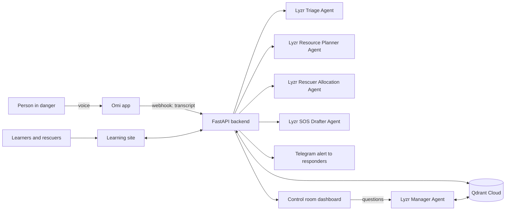

# DisasterReady

**Be ready before the disaster. Be reached when it happens.**

DisasterReady trains people for disasters, certifies volunteer rescuers, and turns a spoken emergency report into a response plan with a certified rescue team.

Built solo for the **Stop Prompting, Solo Agents Hackathon** (AI House x HiDevs).
**Track: Collaborative Multi-Agent Workflows.**

- **Live demo:** https://disasterready-yqoa.onrender.com
- **Demo video:** https://youtu.be/wZyEFH1GZ0U?si=jvRIyLbcAOuI66eb
- **Control-room login:** go to https://disasterready-yqoa.onrender.com/control and use `control@disasterready.demo` / `ready2026` (also shown on the login page)
- **Note:** the site is on a free plan and sleeps when idle, so the first load can take up to a minute.
## Try it in two minutes
1. Open the control room and log in with the demo login above.
2. Under Tools, type a report such as "Fire in a warehouse in LB Nagar. Six workers are trapped inside." and click Send report.
3. Watch the incident appear with the triage, shelter, rescue team, and the agent steps.
4. Ask the Manager Agent: "Which incidents are most severe?"

To report by voice, install the Omi app, open Settings, Developer Settings, Webhooks, turn on Conversation Events, and set the Endpoint URL to `https://disasterready-yqoa.onrender.com/omi/conversation`. Then record a report in Omi.

## The problem

In a flood or fire, control rooms receive many unstructured calls at once, in different languages. Trained volunteers nearby are not known to the control room, and most citizens have never been taught what to do.

## What it does

1. **Learn.** Anyone can register and take a short "Disaster Ready Basics" course. Volunteers can train through three rescuer levels.
2. **Certify.** A rescuer level needs a theory quiz **and** in-person practical training. The certificate is issued only after a trainer confirms the practical in the control room.
3. **Report by voice.** A person speaks into the Omi app, in English, Hindi or Telugu.
4. **Respond.** Five agents triage the report, find shelters, plan resources, allocate certified rescuers by level and area, and alert responders. Rescuers confirm "I'm ready" before dispatch.

Greetings and small talk are filtered out, and the caller is asked to describe a real emergency.

**Knowing who is calling.** People in danger rarely say their name or number. A registered user links their Omi app once by reading out a six-digit code. After that, each of their reports shows the control room their name, a phone number to call, and their GPS position when Omi provides one.

## Architecture



### How the three required tools are used

**Omi (voice input).** The "Conversation Events" webhook sends each finished conversation to `POST /omi/conversation`. The backend returns 200 at once and processes the transcript in a background task.

**Qdrant (vector memory).** Three collections, all 384-dimension cosine vectors from `BAAI/bge-small-en-v1.5` (fastembed):

| Collection | Stores | Used for |
|---|---|---|
| `shelters` | Shelters with area, capacity, facilities, places left | Semantic search for suitable shelters; capacity tracking |
| `incidents` | Every incident and its full record | Duplicate detection (similar reports merge and raise severity), memory for the Manager Agent, persistence across restarts |
| `people` | Learners and rescuers with level and area | Finding rescuers near an incident; account storage |

**Lyzr (agent orchestration).** Five agents built in Lyzr Agent Studio and called through the inference API:

| Agent | Job |
|---|---|
| Triage Agent | Extracts location, hazard, people, injuries and severity as JSON; translates non-English reports; filters non-emergencies |
| Resource Planner Agent | Chooses shelters from Qdrant results and lists supplies |
| Rescuer Allocation Agent | Picks a team from free certified rescuers by level and area |
| SOS Drafter Agent | Writes the short alert for responders |
| Manager Agent | Coordinates the three workers and answers operator questions from incident memory |

Every step is logged with a timestamp and shown on each incident under "How the agents handled this report".

## Pages

| Page | Who | What |
|---|---|---|
| `/` | Everyone | Overview |
| `/learn` | Citizens and volunteers | Register, courses, quizzes, practical booking, certificates, incident assignment |
| `/control` | Control-room operators | Live incidents, rescue teams, dispatch, practical confirmations, Manager Agent |

## Run it locally

Requires Python 3.10 or newer.

```bash
pip install -r requirements.txt
cp .env.example .env      # then fill in your keys
python seed.py            # creates collections and loads sample shelters
uvicorn app:app --port 8000
```

Open http://localhost:8000. To receive Omi reports locally, expose the port with `ngrok http 8000` and set Omi's Conversation Events webhook (Settings, Developer Settings) to `https://YOUR_URL/omi/conversation`.

Without Omi, log in to the control room and use **Send a typed report**. It runs the same agent pipeline.

## Honest limits of this prototype

- **Sample data.** The 15 shelters, 10 of the rescuers (marked "sample") and the training centres are seeded sample data for Hyderabad, not official lists. Sample rescuers confirm "ready" automatically.
- **Training.** The courses are short awareness content, and video lessons are placeholders. The practical step is confirmed by an operator click; nothing verifies real attendance. This is not an official certification.
- **Replies to the caller.** "Help is on the way" and the non-emergency reply are sent through Telegram. Omi notifications are coded but need an Omi app key.
- **Dispatch.** "Dispatch team" updates status and sends messages. It is not connected to real emergency services. In a real emergency, call 112.
- **Caller details.** Omi does not share phone numbers, so a phone number appears only for callers who registered and linked their Omi app. The GPS position is shown only when the Omi app includes one in the report; this could not be confirmed on every phone.
- **Place names.** Speech-to-text can mishear place names; the Triage Agent is given the known areas to correct them, which does not always work.
- **Demo login.** The control-room login is public so judges can try it.

## Tech

FastAPI, Qdrant Cloud, fastembed, Lyzr Agent Studio, Omi, Telegram Bot API. One Python file (`app.py`), no frontend framework.
